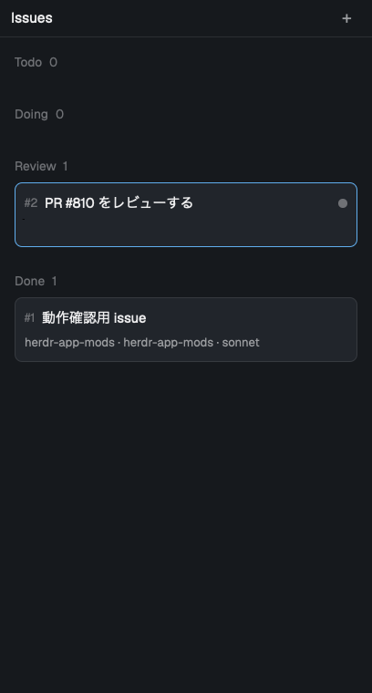

# herdr-app issues mod

An issue kanban for herdr-app, opened from an Issues tab next to Files and Changes. Issues are markdown files; running one from the board starts claude in a git worktree made for that issue, and claude works through it. claude uses the bundled Claude Code skill `herdr-issues` to write its log, a summary and the status back to the issue.



## Features

- A kanban with four columns: Todo / Doing / Review / Done
- Add, edit and delete issues; drag and drop to change status
- Left click shows the body as a markdown preview
- Run from the right-click menu. While an agent is running, "Go to pane" focuses its pane
- When finished, claude writes a `## Summary` into the issue
- Issues done for more than 24 hours are hidden (the file stays)

## Requirements

- herdr-app
- git
- [Claude Code](https://claude.com/claude-code) (the `claude` command)

## Install

Install the mod and the skill separately. Replace `<owner>/<repo>` with this repository.

### Mod

```sh
git clone https://github.com/<owner>/<repo>.git herdr-app-mods
cd herdr-app-mods
./install.sh
```

`install.sh` copies `mods/issues` to `~/.config/herdr-app/mods/issues` (herdr-app ignores symlinked mod folders). It also copies `mods/tabs-issues` (a clone of the tab bar with an Issues button next to Files and Changes) and `layouts/main-issues.json` (the layout that puts Issues in the right panel; it uses `agents-ws` / `pane-ws` when installed, otherwise the default `agents` / `pane`), and symlinks the skill to `~/.claude/skills/herdr-issues`. Run it again after editing the mod. If you install the skill with one of the methods below instead, remove `~/.claude/skills/herdr-issues` so the skill isn't loaded twice.

### Skill: Claude Code plugin

This repository is also a plugin marketplace (`.claude-plugin/marketplace.json`) holding the `herdr-issues` plugin. In Claude Code:

```
/plugin marketplace add <owner>/<repo>
/plugin install herdr-issues@herdr-app-mods
```

On Claude Code 2.1.275 or later this works in one step:

```
/plugin install herdr-issues --marketplace <owner>/<repo>
```

From a shell: `claude plugin marketplace add <owner>/<repo>` then `claude plugin install herdr-issues@herdr-app-mods`.

### Skill: npx skills

With [skills](https://github.com/vercel-labs/skills) (Node.js 22.20 or later):

```sh
npx skills add <owner>/<repo> --skill herdr-issues -a claude-code -g
```

`-g` installs it for your user instead of the current project; `-a claude-code` targets Claude Code.

## Usage

### Keys (when the board has focus)

| Key | Action |
| --- | --- |
| `j` / `k` | Move selection |
| `n` | New issue |
| `e` / `enter` | Edit |
| `d` | Delete (asks first) |
| `r` | Run |
| `[` / `]` | Move to previous / next column |

### Issue file

Issues are saved as `~/.config/herdr-app/data/issues/<id>.md`.

```markdown
---
id: 12
title: Fix login form validation
status: todo
workspace: backend
repository: /path/to/repo
model: opus
worktree:
created: 2026-11-10 10:00
updated: 2026-11-10 10:00
---
## Description
What to do

## Acceptance criteria
- [ ] `make test` passes

## Summary
Written by claude when it finishes.

## Log
```

| Key | Meaning |
| --- | --- |
| `workspace` | herdr space to run in. An existing space gets a new tab; otherwise a space with that name is created. Empty: `#<id> <title>` |
| `repository` | git repository to create the worktree from |
| `model` | Model passed to `claude --model` |
| `worktree` | Worktree path. Empty: created at `~/.herdr/worktrees/<repo>/<branch>` |

`branch`, `space`, `tab` and `done_at` are written automatically on run and status changes.

### What a run does

1. Creates a worktree on branch `issue/<id>-<title>` in `repository` (reuses it if it exists).
2. Starts claude in the `workspace` space or tab and asks it to work on the issue.
3. claude logs milestones with the `herdr-issues` skill, checks off acceptance criteria it has verified, writes a summary, and sets the status to `review`.
4. After reviewing, move the issue to Done.

### Skill

Ask Claude Code things like "create an issue" or "add a log entry to #3", or call the script directly:

```sh
S=~/.claude/skills/herdr-issues/issues.sh   # with install.sh; elsewhere for plugin / npx installs
$S list
$S new "Title" /path/to/repo
$S log 3 "Added tests"
$S check 3 1
$S summary 3 "What was done, results, open points"
$S status 3 review
$S run 3        # same as Run on the board (herdr-app must be running)
```

## Notes

- Running an issue executes `git` and `claude` and creates worktrees under `~/.herdr/worktrees/`.
- In a new worktree, claude may ask whether to trust the folder when it starts.

## Development

Tests use [Bun](https://bun.sh)'s test runner; no dependencies to install.

```sh
bun test            # all tests
bun run test        # with coverage (fails below 90%)
```

`test/fakes.js` replaces the herdr-app runtime modules (`herdr`, `gpui-kit`, `gpui-base`) so the mod runs outside the app. `test/issues-sh.test.js` runs `issues.sh` against a temporary `ISSUES_DIR`.

## Files

```
mods/issues/          the mod (main.js, store.js, runner.js, mod.json)
skills/herdr-issues/  Claude Code skill (SKILL.md, issues.sh)
.claude-plugin/       Claude Code plugin and marketplace manifests
install.sh            installer
test/                 bun tests
RECIPE.md             recipe for herdr.dev/mods
preview.png           screenshot
```
