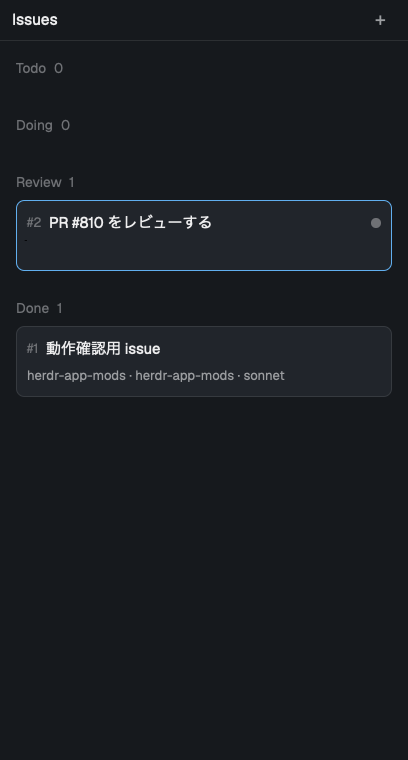

# Issues

An issue kanban in the right panel, opened from an Issues tab next to Files and Changes. Each issue is one markdown file with frontmatter; issues can be added, edited, deleted and moved between statuses, and "Run" starts claude in a git worktree made for the issue so it works through it. claude writes its log, a summary and the status back to the file with the bundled `herdr-issues` skill, and the board updates immediately.

## What you see

- A page in the right panel stack next to Files and Changes, on `theme().chrome`. `tabs-issues` (a clone of the tab bar) adds the Issues button.
- A 34px header: "Issues" on the left (13px, semibold), "+" (new issue) on the right.
- Below it four stacked columns: Todo / Doing / Review / Done. Each heading shows the column name and count (11.5px, `dim`).
- Cards: radius 7, `background` fill. The border takes the color of the space the issue ran in (the same `space.colors` palette as the shipped spaces mod); without one it is `border`, or `accent` when selected (a selected colored card gets the `selected` fill instead). Line 1: `#id` (dim), title (12.5px, truncated), `☑ done/total` when there are acceptance criteria (`done` color when all are met), and an 8px dot in the space's status color. Line 2: workspace · repository name · model · branch (11px, muted).
- Cards done for more than 24 hours are hidden (the file stays).

## How it behaves

- Left click: a markdown preview dialog (640×520) of the body, with an × close button at the top right and ▶ Run and Edit buttons; Esc or a click outside closes it.
- Right click: a popup menu. While an agent is running for the issue, "Go to pane" comes first (selects its space / tab and focuses the agent's pane). Then ▶ Run, Edit, Move to each column, Delete (asks first).
- Drag and drop: dropping a card on another column changes its status. The dragged card is half transparent; the target column gets an `accent` border.
- Keys (when the panel has focus): j/k select, n new, e/enter edit, d delete, r run, [ / ] move to the previous / next column.
- Edit dialog: a title Input and a markdown Editor for the body. New bodies start with "## Description / ## Acceptance criteria (`- [ ]`) / ## Log". repository is filled with the focused pane's cwd on create.
- ▶ Run:
  1. If its space / tab is already open, just focus it.
  2. Resolve `repository` with `git rev-parse --show-toplevel` and create a worktree on branch `issue/<id>-<slug>` at `worktree` (empty: `~/.herdr/worktrees/<repo>/<slug>`). An existing worktree is reused.
  3. If `workspace` names an existing space, `tab.new` there; otherwise `space.new` (named workspace or `#id title`). argv is `claude` (`--model <model>` when set).
  4. The task tells claude to use the herdr-issues skill: do `## Description`, log milestones, check off verified criteria, write a summary, set status to review.
  5. Write status=doing, branch, worktree, space, tab to the frontmatter and log "Run started". On failure, notify and log "Run failed".
- `issues.<cmd>`: the board takes `run-<id>` from `nextCommand()`, so `herdr-app do issues.run-3` (what `issues.sh run 3` calls) runs issue 3.
- The folder is watched with `watchFolder`, so changes from the skill redraw at once. A 10-minute timer redraws for the 24h cutoff.

## Built from

- `mods/issues/mod.json`: `{ "place": "none", "focusable": true }`. `layouts/main-issues.json` puts it in the `panel-body` stack..
- `mods/issues/main.js`: one mod with four views chosen by props. No props = Board, `{view:"edit", id?}` = edit dialog, `{view:"view", id}` = preview dialog, `{view:"menu", id, confirm}` = popup menu. Uses `openOverlay` / `closeOverlay`, `shared("space.colors")`, `TextView.markdown`, `InputState`+`Input`, `EditorState`+`Editor` (gpui-base).
- `mods/issues/store.js`: saves to `appHome()/data/issues/<id>.md`. A small `key: value` frontmatter parser / writer, log append, acceptance-criteria reader, conflict detection through `writeTextFile`'s expected text. Frontmatter keys: id, title, status, workspace, repository, model, branch, worktree, space, tab, created, updated, done_at.
- `mods/issues/runner.js`: `exec("git", …)`, `spaces()` / `agents()`, `run("space.new" | "tab.new" | "space.select" | "tab.select" | "pane.focus")`, `notify`.
- `skills/herdr-issues/`: a Claude Code skill (SKILL.md and bash-only `issues.sh`: list / show / path / new / set / check / summary / status / log / run).
- Programs it runs: `git`, `claude`. Places outside its folder it reads or writes: `~/.config/herdr-app/data/issues/`, `~/.herdr/worktrees/`, the `repository` git repo.

## Watch out

- herdr-app ignores symlinked mod folders. `install.sh` copies (run it again after edits).
- `on_click` on a card stops the mouse_down-based drag and drop. Detect a click in the column's `on_mouse_up` as "released over its own column".
- `closeOverlay` cancels that copy's tasks. Menu actions finish inside `cx.spawn` before closing.
- The skill is not part of the herdr-app package; without `~/.claude/skills/herdr-issues`, the started claude cannot write its log.
- In a new worktree claude may ask to trust the folder when it starts.
- In awk, `in` is a reserved word.

## Done when

- `herdr-app check mods/issues` passes.
- A file made with `issues.sh new "test"` shows up in Todo at once.
- `issues.sh status <id> doing` moves the card to Doing.
- Dropping a card on Review sets `status: review` in the file.
- Left click opens the body preview.
- `issues.sh summary <id> "text"` adds a `## Summary` section before `## Log` and replaces it on the next call.
- Running an issue whose repository is a git repo shows `issue/<id>-…` in `git worktree list`, starts claude in a new space (or tab), and logs "Run started". Meanwhile the right-click menu shows "Go to pane".
